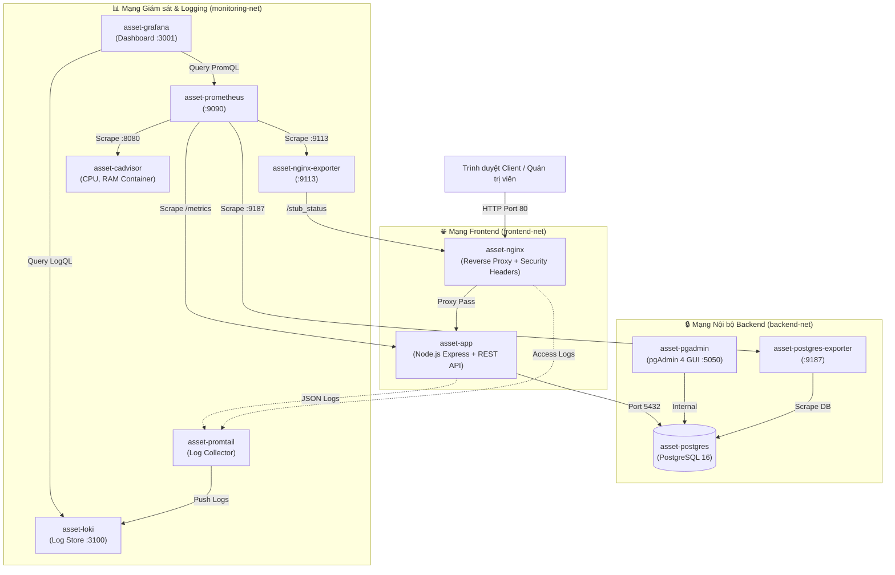

# 🏢 Hệ thống Quản lý Tài sản / Thiết bị (Đề 16)
### Môn học: Triển khai và Quản trị Hệ thống Phần mềm
- **Sinh viên thực hiện:** Hoàng Trang Hiền
- **Mã sinh viên:** DTC245200494
- **Lớp / Trường:** Trường Đại học Công nghệ Thông tin & Truyền thông (ICTU)
- **Giảng viên hướng dẫn:** Bộ môn Hệ thống Thông tin & Mạng Máy tính
- **Repository GitHub:** [dtc245200494-hue/asset-management](https://github.com/dtc245200494-hue/asset-management)

---

## 📌 1. Giới thiệu Đề tài
Dự án được xây dựng nhằm giải quyết bài toán quản trị và theo dõi toàn bộ vòng đời tài sản / thiết bị phần cứng, máy móc, trang thiết bị văn phòng của cơ quan/doanh nghiệp: từ khi mua mới, bàn giao sử dụng, bảo dưỡng - sửa chữa định kỳ cho đến khi thanh lý.

Điểm trọng tâm của môn học là **Triển khai và Quản trị Hệ thống Phần mềm**, do đó dự án tập trung tối đa vào:
- **Tính khả thi và ổn định:** Cơ sở dữ liệu quan hệ PostgreSQL 16 thực tế, chuẩn hóa dữ liệu, nạp sẵn seed data 18+ thiết bị đa dạng và lịch sử sửa chữa.
- **Tự động hóa triển khai:** 100% dịch vụ được đóng gói và vận hành qua một lệnh duy nhất bằng **Docker Compose** (gồm 11 container chuyên biệt).
- **Độ tin cậy & Giám sát toàn diện (Observability):** Giám sát thời gian thực qua **Prometheus + Grafana**, đo đạc tài nguyên container (**cAdvisor**), metrics cơ sở dữ liệu (**PostgreSQL Exporter**), reverse proxy (**Nginx Exporter**) và metrics ứng dụng (**prom-client**).
- **Quản lý Log tập trung (Centralized Logging):** Thu thập toàn bộ log ứng dụng và container qua **Loki + Promtail**, hỗ trợ truy vấn chuyên sâu bằng **LogQL**.
- **Bảo mật và Tối ưu hóa (Hardening):** Áp dụng 6 biện pháp bảo mật thực tế (chạy container non-root, cô lập mạng multi-tier, cô lập port cơ sở dữ liệu, Nginx security headers, quản lý bí mật `.env`).

---

## 🏗️ 2. Kiến trúc Hệ thống (System Architecture)

Hệ thống bao gồm **11 dịch vụ Docker** được phân tách thành 3 phân vùng mạng biệt lập:



### Danh sách 11 Container trong Hệ thống:
| STT | Tên Container | Image gốc | Vai trò / Chức năng chính | Cổng (Host Binding) |
|:---:|:---|:---|:---|:---|
| 1 | `asset-nginx` | `nginx:1.25-alpine` | Reverse proxy, chặn header độc hại, cân bằng tải | `80:80` |
| 2 | `asset-app` | `node:20-alpine` (Custom) | Ứng dụng Quản lý Tài sản, REST API, Prom-client | Không mở (Internal 3000) |
| 3 | `asset-postgres` | `postgres:16-alpine` | Cơ sở dữ liệu quan hệ PostgreSQL 16 | Không mở (Internal 5432) |
| 4 | `asset-pgadmin` | `dpage/pgadmin4:8` | Giao diện đồ họa quản trị cơ sở dữ liệu | `127.0.0.1:5050:80` |
| 5 | `asset-prometheus` | `prom/prometheus:v2.51.0` | Thu thập và lưu trữ time-series metrics | `127.0.0.1:9090:9090` |
| 6 | `asset-grafana` | `grafana/grafana:10.4.0` | Dashboard giám sát trực quan hóa metrics & logs | `3001:3000` |
| 7 | `asset-cadvisor` | `gcr.io/cadvisor/cadvisor:v0.49.1` | Giám sát chỉ số phần cứng container (CPU, RAM, Disk) | `127.0.0.1:8080:8080` |
| 8 | `asset-postgres-exporter`| `prometheuscommunity/postgres-exporter:v0.15.0` | Trích xuất metrics PostgreSQL sang định dạng Prometheus | Internal 9187 |
| 9 | `asset-nginx-exporter` | `nginx/nginx-prometheus-exporter:1.1.0` | Thu thập metrics từ Nginx `/stub_status` | Internal 9113 |
| 10 | `asset-loki` | `grafana/loki:3.0.0` | Cơ sở dữ liệu tập trung lưu trữ logs | `127.0.0.1:3100:3100` |
| 11 | `asset-promtail` | `grafana/promtail:3.0.0` | Đọc logs container/app và đẩy về Loki | Nội bộ (Agent) |

---

## 💾 3. Thiết kế Cơ sở Dữ liệu (Database Design)

Cơ sở dữ liệu gồm 4 bảng thực thể chính theo chuẩn Đề 16:
1. **`users`**: Tài khoản quản trị, người dùng, phân quyền (ADMIN, MANAGER, STAFF), mật khẩu băm bcrypt.
2. **`categories`**: Danh mục phân loại tài sản (Máy tính & Laptop, Màn hình hiển thị, Thiết bị in ấn, Thiết bị mạng, v.v.).
3. **`assets`**: Thông tin chi tiết thiết bị, mã tài sản duy nhất (unique asset_code), ngày mua, đơn giá, trạng thái (`IN_USE`, `MAINTENANCE`, `AVAILABLE`, `DISPOSED`), vị trí lắp đặt.
4. **`maintenance_history`**: Nhật ký sửa chữa, ngày bảo dưỡng, kỹ thuật viên thực hiện, chi phí phát sinh và tình trạng sau sửa chữa.

---

## 🚀 4. Hướng dẫn Khởi chạy Hệ thống

### Yêu cầu tiên quyết:
- Cài đặt **Docker Desktop** (trên Windows / macOS) hoặc **Docker Engine + Docker Compose Plugin** (trên Ubuntu / Linux VPS).
- Git.

### Các bước khởi động:

1. **Clone repository về máy:**
   ```bash
   git clone https://github.com/dtc245200494-hue/asset-management.git
   cd asset-management
   ```

2. **Chuẩn bị file cấu hình môi trường:**
   ```bash
   # Nếu chưa có file .env, copy từ .env.example
   cp .env.example .env
   ```

3. **Khởi động toàn bộ 11 container:**
   ```bash
   docker compose up -d --build
   ```

4. **Kiểm tra trạng thái các container:**
   ```bash
   docker compose ps
   ```
   *Tất cả 11 container cần có trạng thái `Up` (hoặc `healthy`).*

---

## 🌐 5. Địa chỉ Truy cập & Tài khoản Quản trị

| Dịch vụ | Địa chỉ URL | Tài khoản / Mật khẩu mặc định | Ghi chú |
|:---|:---|:---|:---|
| **Website Quản lý Tài sản** | [http://localhost](http://localhost) | `admin` / `admin123` | Truy cập qua Nginx Reverse Proxy (Port 80) |
| **Prometheus Metrics Web** | [http://localhost/metrics](http://localhost/metrics) | Không yêu cầu | Endpoint xuất metrics từ `prom-client` |
| **Grafana Dashboard** | [http://localhost:3001](http://localhost:3001) | `admin` / `GrafanaSecure2026!` | Đã tích hợp sẵn Dashboard & Datasources |
| **Prometheus Targets** | [http://localhost:9090/targets](http://localhost:9090/targets) | Không yêu cầu | Xem tình trạng UP của 4 target exporters |
| **pgAdmin 4** | [http://localhost:5050](http://localhost:5050) | `admin@ictu.edu.vn` / `AdminSecure2026!Passwd` | Đăng nhập để quản lý PostgreSQL |
| **cAdvisor Metrics** | [http://localhost:8080](http://localhost:8080) | Không yêu cầu | Xem thông số phần cứng container |

---

## 📊 6. Giám sát & Truy vấn Log (Prometheus & Loki)

### A. Kiểm tra Prometheus Targets
Truy cập [http://localhost:9090/targets](http://localhost:9090/targets), đảm bảo cả 4 target đều hiển thị màu xanh lá cây (**UP**):
- `node-app` (`app:3000`)
- `cadvisor` (`cadvisor:8080`)
- `postgres` (`postgres-exporter:9187`)
- `nginx` (`nginx-exporter:9113`)

### B. Ba (03) Truy vấn LogQL mẫu trên Grafana Loki:
Vào **Grafana** ([http://localhost:3001](http://localhost:3001)) -> Menu **Explore** -> Chọn Data source **Loki**:

1. **Xem toàn bộ log phát sinh từ ứng dụng website:**
   ```logql
   {service="app"}
   ```

2. **Lọc riêng các dòng log chứa thông báo lỗi cấp độ ERROR:**
   ```logql
   {service="app"} |= "ERROR"
   ```
   *(Mẹo: Bấm nút **"Test Error Log (Loki)"** trên thanh Navbar của website để chủ động kích hoạt lỗi 500 giả lập phục vụ demo!)*

3. **Thống kê tổng số lượng log ghi nhận trong 5 phút gần nhất:**
   ```logql
   sum(count_over_time({service="app"}[5m]))
   ```

---

## 🛡️ 7. Minh chứng Biện pháp Bảo mật (Hardening)

Hệ thống được thiết kế tuân thủ nghiêm ngặt các tiêu chuẩn an ninh thông tin:

1. **Chạy ứng dụng bằng người dùng không đặc quyền (Non-root user):**
   - File `backend/Dockerfile` sử dụng `USER node` (UID 1000).
   - *Lệnh kiểm tra minh chứng:*
     ```bash
     docker compose exec asset-app id
     # Kết quả: uid=1000(node) gid=1000(node)
     ```

2. **Phân tách mạng đa tầng (Multi-tier Network Isolation):**
   - Mạng `frontend-net`: Nginx <--> App.
   - Mạng `backend-net`: App <--> PostgreSQL, pgAdmin <--> PostgreSQL.
   - Mạng `monitoring-net`: Prometheus, Grafana, Exporters, Loki, Promtail.
   - *Lệnh kiểm tra:* `docker network inspect asset-management_backend-net`

3. **Ẩn cổng Database (Database Port Concealment):**
   - Container `asset-postgres` chỉ dùng lệnh `expose: - "5432"`, không hề ánh xạ `ports:` ra ngoài máy host. Hacker từ mạng ngoài không thể scan thấy port 5432 để tấn công brute-force.

4. **Nginx Security Headers & Server Masking:**
   - Đã cấu hình `server_tokens off;` (ẩn phiên bản Nginx).
   - Đã kích hoạt các security headers quan trọng: `X-Frame-Options`, `X-Content-Type-Options`, `X-XSS-Protection`, `Referrer-Policy`, `Content-Security-Policy`.
   - *Lệnh kiểm tra minh chứng:*
     ```bash
     curl -I http://localhost
     ```

5. **Quản lý biến môi trường an toàn (Secrets Isolation):**
   - Mật khẩu cơ sở dữ liệu, secret token, admin password được tách biệt hoàn toàn trong file `.env` (được đưa vào `.gitignore` để không bao giờ bị lộ lên GitHub).

---

## 📑 8. Lịch sử Commit có ý nghĩa (Git Milestones)

Dự án được xây dựng và đẩy lên GitHub theo các giai đoạn chuẩn:
- **Commit 1:** `feat: deploy asset management with PostgreSQL and Nginx` (Khởi tạo Website CRUD, DB Schema 4 bảng, Docker Compose & Nginx Proxy).
- **Commit 2:** `feat: add Prometheus Grafana and exporters` (Tích hợp prom-client, cAdvisor, postgres-exporter, nginx-exporter & Grafana Dashboard).
- **Commit 3:** `feat: integrate Loki Promtail and LogQL monitoring` (Tích hợp hệ thống log tập trung Loki + Promtail và cấu hình truy vấn LogQL).
- **Commit 4:** `feat: apply security hardening, sample data and documentation` (Hardening container, non-root user, security headers, tài liệu báo cáo).
