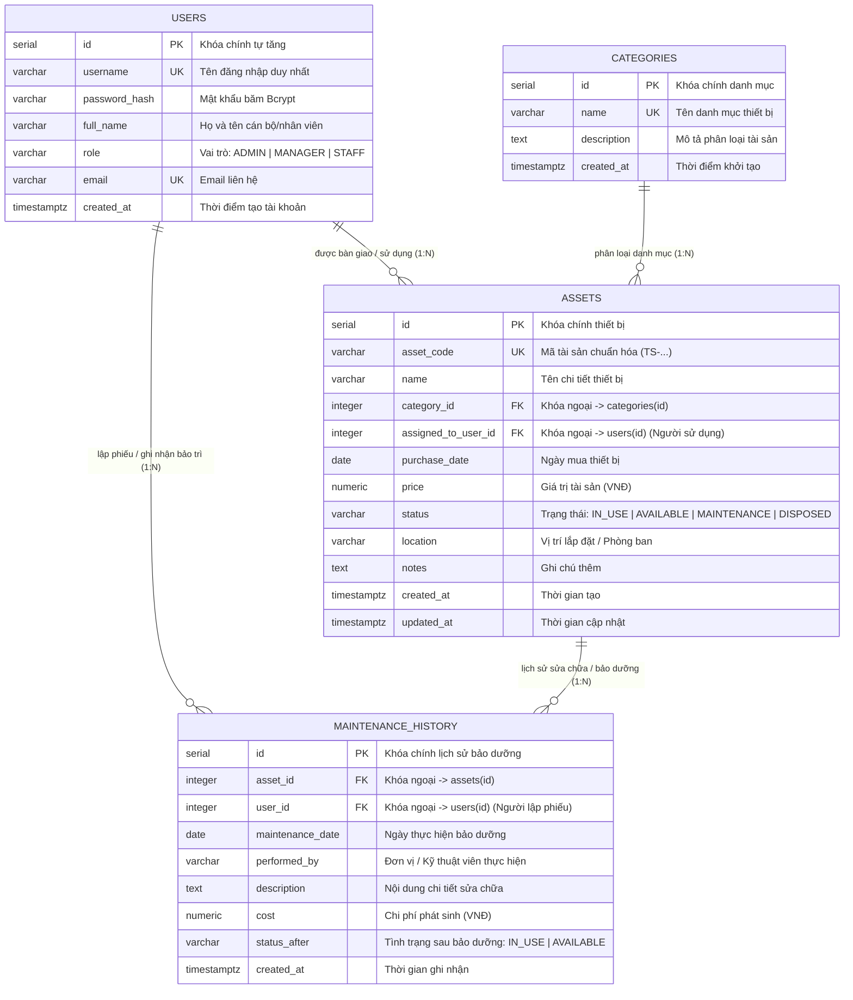

# SƠ ĐỒ QUAN HỆ CƠ SỞ DỮ LIỆU (ENTITY RELATIONSHIP DIAGRAM - ERD)
**Đề tài**: Đề 16 – Hệ thống Quản lý Tài sản / Thiết bị  
**Học phần**: Triển khai và Quản trị Hệ thống Phần mềm  
**Sinh viên thực hiện**: DTC245200494 (Hoàng Trang Hiền)  
**Hệ quản trị CSDL**: PostgreSQL 16 Alpine (`assetdb`)  

---

## 1. Sơ Đồ ERD Quan Hệ Giữa Các Bảng (Entity Relationship Diagram)

Hệ thống cơ sở dữ liệu gồm 4 bảng thực thể được chuẩn hóa đến dạng chuẩn **3NF (Third Normal Form)**, kết nối chặt chẽ thông qua các khóa chính (**Primary Key**) và khóa ngoại (**Foreign Key**):

---

## 2. Bảng Danh Mục Các Khóa Ngoại (Foreign Keys Matrix)

| Bảng Chứa Khóa Ngoại | Cột Khóa Ngoại | Bảng Được Tham Chiếu | Cột Khóa Chính | Ý Nghĩa Nghiệp Vụ & Ràng Buộc |
|---|---|---|---|---|
| **`assets`** | `category_id` | **`categories`** | `id` | **ON DELETE RESTRICT**: Không được xóa danh mục nếu đang có tài sản trực thuộc. |
| **`assets`** | `assigned_to_user_id` | **`users`** | `id` | **ON DELETE SET NULL**: Khi xóa nhân viên, tài sản tự động chuyển về trạng thái chưa gán người dùng. |
| **`maintenance_history`** | `asset_id` | **`assets`** | `id` | **ON DELETE CASCADE**: Khi thanh lý/xóa thiết bị, toàn bộ lịch sử sửa chữa của thiết bị đó sẽ được xóa đồng bộ. |
| **`maintenance_history`** | `user_id` | **`users`** | `id` | **ON DELETE SET NULL**: Người dùng/Admin lập phiếu ghi nhận bảo trì trong hệ thống. |

---

## 3. Các Chỉ Mục (Indexes) Tối Ưu Hóa Hiệu Năng
- `idx_assets_category_id` trên `assets(category_id)`: Tăng tốc lọc tài sản theo danh mục.
- `idx_assets_assigned_to` trên `assets(assigned_to_user_id)`: Tăng tốc truy vấn danh sách tài sản được bàn giao cho từng nhân viên.
- `idx_assets_status` trên `assets(status)`: Tối ưu thống kê trên Dashboard (IN_USE, AVAILABLE,...).
- `idx_maintenance_asset_id` trên `maintenance_history(asset_id)`: Tăng tốc truy vấn toàn bộ lịch sử sửa chữa của 1 thiết bị.
- `idx_maintenance_user_id` trên `maintenance_history(user_id)`: Tối ưu tra cứu nhật ký bảo trì do từng kỹ thuật viên lập.
