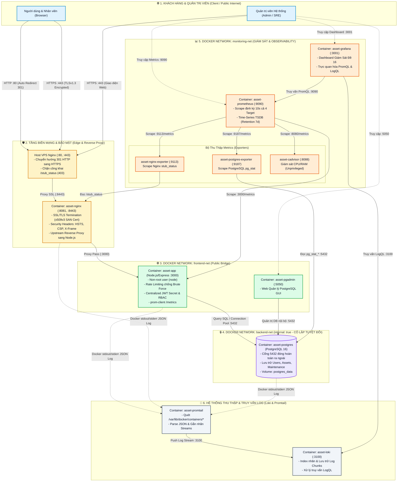

# SƠ ĐỒ VÀ THIẾT KẾ KIẾN TRÚC TỔNG THỂ HỆ THỐNG
**Đề tài**: Đề 16 – Hệ thống Quản lý Tài sản / Thiết bị  
**Học phần**: Triển khai và Quản trị Hệ thống Phần mềm  
**Sinh viên thực hiện**: DTC245200494 (Hoàng Trang Hiền)  
**Địa chỉ Cloud VPS**: `180.93.106.7`  
**GitHub Repository**: [dtc245200494-hue/asset-management](https://github.com/dtc245200494-hue/asset-management)  

---

## 1. Sơ Đồ Kiến Trúc Hệ Thống Tổng Thể (System Architecture Diagram)

Hệ thống được thiết kế theo kiến trúc **Microservices phân tầng**, đóng gói và điều phối hoàn chỉnh qua **Docker Compose** với **11 containers**, được cô lập bằng **3 phân vùng mạng Docker Networks độc lập** và tích hợp đầy đủ hệ thống Giám sát Metrics, Thu thập Logs và Cơ chế Bảo mật Hardening chuyên sâu.

---

## 2. Chi Tiết Các Tầng Kiến Trúc

### 2.1. Tầng Khách Hàng (Client / Public Internet)
- **Người dùng phổ thông (Staff / Viewer)**: Truy cập website qua trình duyệt web trên máy tính hoặc điện thoại. Mọi kết nối ban đầu từ cổng 80 (HTTP) đều được tự động chuyển hướng 301 sang cổng 443 (HTTPS).
- **Quản trị viên (Admin / SRE)**: Có quyền truy cập các cổng quản trị chuyên dụng:
  - Website quản lý tài sản: `https://180.93.106.7`
  - Dashboard trực quan Grafana: `http://180.93.106.7:3001`
  - Quản trị cơ sở dữ liệu pgAdmin 4: `http://180.93.106.7:5050`
  - Hệ thống giám sát Prometheus Targets: `http://180.93.106.7:9090`

---

### 2.2. Tầng Biên Mạng & Reverse Proxy (Edge / Ingress Layer)
- **Host Nginx**:
  - Đóng vai trò làm cổng vào cấp hệ điều hành (Port 80 và 443).
  - Tự động chuyển hướng toàn bộ lưu lượng HTTP sang HTTPS với mã trạng thái `301 Moved Permanently`.
  - Chặn triệt để truy cập từ ngoài Internet vào endpoint `/stub_status` (trả về `403 Forbidden`).
  - Chuyển tiếp lưu lượng an toàn sang container `asset-nginx` qua cổng nội bộ `8443`.
- **Container `asset-nginx` (Nginx 1.25 Alpine)**:
  - **Mã hóa TLS/SSL**: Kết thúc phiên mã hóa (TLS Termination) với chuẩn **TLSv1.2** và **TLSv1.3**, sử dụng chứng chỉ số x509v3 có hỗ trợ SAN (`IP:180.93.106.7`, `DNS:localhost`).
  - **Security Headers đa lớp**:
    - `Strict-Transport-Security: max-age=31536000; includeSubDomains`: Ép buộc trình duyệt chỉ dùng HTTPS.
    - `X-Frame-Options: SAMEORIGIN`: Ngăn chặn tấn công Clickjacking.
    - `X-Content-Type-Options: nosniff`: Ngăn chặn MIME-type sniffing.
    - `Content-Security-Policy`: Siết chặt với `default-src 'self'`, cấm `unsafe-eval`, chỉ cho phép tài nguyên CDN đã kiểm duyệt.
  - **Kiểm soát nội bộ `/stub_status`**: Cấp quyền truy cập duy nhất cho các dải IP nội bộ Docker (`172.16.0.0/12`, `127.0.0.1`) để exporter cào chỉ số.

---

### 2.3. Tầng Ứng Dụng (Application Layer)
- **Container `asset-app` (Node.js 20 Alpine)**:
  - Chạy ứng dụng Express.js phục vụ RESTful API và giao diện HTML/CSS/JS.
  - **Bảo mật Container**: Chạy dưới quyền người dùng không đặc quyền **`node` (non-root)** với UID 1000.
  - **Chống Brute Force**: Tích hợp middleware `express-rate-limit`, giới hạn 10 lần thử đăng nhập sai trong vòng 15 phút từ cùng một IP (vượt ngưỡng trả về `429 Too Many Requests`).
  - **Xác thực & Phân quyền**:
    - Mật khẩu lưu trữ băm một chiều bằng thuật toán **Bcrypt** an toàn.
    - Sử dụng **JWT (JSON Web Token)** với `SESSION_SECRET` tập trung, bắt buộc biến môi trường tối thiểu 32 ký tự, không dùng fallback.
    - Phân quyền theo vai trò (RBAC): Các API thay đổi dữ liệu (`POST`, `PUT`, `DELETE`) trên tài sản và lịch sử bảo trì bắt buộc phải có quyền `ADMIN` hoặc `MANAGER`.
  - **Metrics Engine**: Tích hợp thư viện `prom-client` cung cấp endpoint nội bộ `/metrics` đo thời gian phản hồi (Latency Histogram) và số lượng yêu cầu (Request Counter).

---

### 2.4. Tầng Cơ Sở Dữ Liệu (Database Layer)
- **Container `asset-postgres` (PostgreSQL 16 Alpine)**:
  - Lưu trữ toàn bộ dữ liệu người dùng, danh mục thiết bị, tài sản và lịch sử bảo trì.
  - **Cách ly tuyệt đối (Network Isolation)**: Container chỉ kết nối duy nhất vào mạng **`backend-net`** với cờ **`internal: true`**. Cổng 5432 hoàn toàn không được publish ra ngoài host, ngăn chặn mọi cuộc tấn công quét cổng từ Internet.
  - Dữ liệu được lưu trữ bền vững qua Docker Volume **`postgres_data`**.
- **Container `asset-pgadmin` (pgAdmin 4)**:
  - Cung cấp giao diện Web trực quan để quản trị PostgreSQL qua cổng 5050.
  - Kết nối đồng thời vào `frontend-net` (để nhận yêu cầu đăng nhập) và `backend-net` (để truy vấn database).

---

### 2.5. Tầng Giám Sát Metrics (Monitoring Layer)
- **Nhóm Exporters thu thập chỉ số**:
  - `asset-nginx-exporter` (Cổng 9113): Đọc chỉ số kết nối từ Nginx `/stub_status`.
  - `asset-postgres-exporter` (Cổng 9187): Kết nối nội bộ vào database đọc các bảng thống kê `pg_stat_*`.
  - `asset-cadvisor` (Cổng 8088): Thu thập thông số sử dụng CPU, RAM, Network I/O của toàn bộ 11 containers. Được cấu hình bảo mật **`privileged: false`** và **`no-new-privileges: true`**.
  - `asset-app` (Cổng 3000): Xuất metrics hiệu năng của Node.js qua `/metrics`.
- **Container `asset-prometheus` (Prometheus 2.51.0)**:
  - Định kỳ 10 giây một lần (scrape interval), Prometheus kéo toàn bộ metrics từ 4 targets trên qua mạng nội bộ `monitoring-net`.
  - Lưu trữ chỉ số theo chuỗi thời gian (TSDB) với thời gian lưu giữ 7 ngày.
- **Container `asset-grafana` (Grafana 10.4.0)**:
  - Cổng truy cập 3001.
  - Tự động nạp cấu hình Datasource Prometheus và Loki qua cơ chế Provisioning.
  - Tích hợp sẵn Dashboard "Đề 16 - Giám sát Hệ thống Quản lý Tài sản" hiển thị trực quan các biểu đồ tài nguyên, lưu lượng mạng và trạng thái container.

---

### 2.6. Tầng Quản Lý & Truy Vấn Log (Logging Layer)
- **Container `asset-promtail` (Promtail 3.0.0)**:
  - Chạy như một Log Agent, mount thư mục log container của Docker (`/var/lib/docker/containers/*`).
  - Tự động phân tích cú pháp JSON, gán nhãn luồng log (`job="docker"`, `service_name`, `stream`) và gửi về Loki.
- **Container `asset-loki` (Grafana Loki 3.0.0)**:
  - Lưu trữ log theo dạng Chunks nén và lập chỉ mục metadata cho nhãn, giúp tiết kiệm dung lượng lưu trữ.
  - Hỗ trợ ngôn ngữ truy vấn **LogQL** phục vụ việc điều tra lỗi hệ thống từ giao diện Grafana Explore (ví dụ: `{service="app"} |= "ERROR"`).

---

## 3. Ma Trận Phân Vùng Mạng (Network Segmentation Matrix)

| Dịch vụ / Container | `frontend-net` (Bridge) | `backend-net` (internal: true) | `monitoring-net` (Bridge) | Ghi chú an ninh |
|---|:---:|:---:|:---:|---|
| `asset-nginx` | ✅ | ❌ | ✅ | Cổng vào công khai duy nhất |
| `asset-app` | ✅ | ✅ | ✅ | Cầu nối giữa giao diện và dữ liệu |
| `asset-postgres` | ❌ | ✅ | ❌ | **Cách ly 100% trong mạng internal** |
| `asset-pgadmin` | ✅ | ✅ | ❌ | Quản lý DB nội bộ |
| `asset-postgres-exporter` | ❌ | ✅ | ✅ | Đọc DB metrics và cấp cho Prometheus |
| `asset-nginx-exporter` | ✅ | ❌ | ✅ | Đọc Nginx metrics |
| `asset-cadvisor` | ❌ | ❌ | ✅ | Giám sát tài nguyên container |
| `asset-prometheus` | ❌ | ❌ | ✅ | Trung tâm thu thập metrics |
| `asset-grafana` | ✅ | ❌ | ✅ | Giao diện trực quan hóa |
| `asset-loki` | ❌ | ❌ | ✅ | Lưu trữ log tập trung |
| `asset-promtail` | ❌ | ❌ | ✅ | Thu thập log container |

---
*Tài liệu kiến trúc chuẩn hóa phục vụ thẩm định và bảo vệ đồ án môn học Triển khai và Quản trị Hệ thống Phần mềm (Đề 16).*
