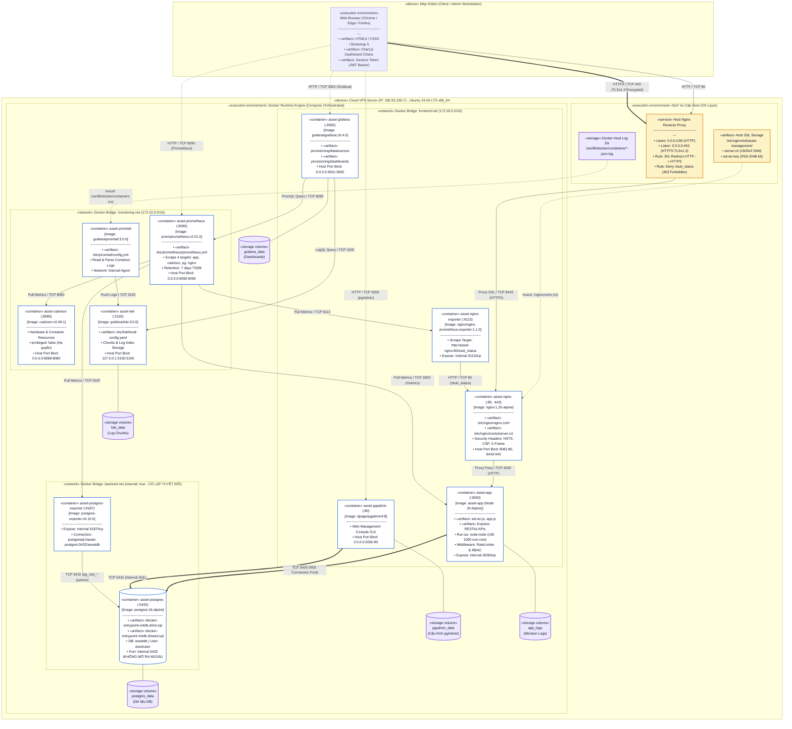

# SƠ ĐỒ TRIỂN KHAI HỆ THỐNG (UML DEPLOYMENT DIAGRAM)
**Đề tài**: Đề 16 – Hệ thống Quản lý Tài sản / Thiết bị  
**Học phần**: Triển khai và Quản trị Hệ thống Phần mềm  
**Sinh viên thực hiện**: DTC245200494 (Hoàng Trang Hiền)  
**Môi trường thực tế**: Cloud VPS Ubuntu 24.04 LTS (`180.93.106.7`)  

---

## 1. Sơ Đồ Triển Khai UML (Deployment Diagram)

Sơ đồ thể hiện cụ thể:
1. **Thiết bị vật lý/máy khách (Client Device)** và trình duyệt.
2. **Máy chủ đám mây (Cloud VPS Node)**, hệ điều hành Ubuntu, Host Nginx và Docker Engine.
3. **Các Container thực thi («execution environment» / «container»)** và các tệp thành phần triển khai («artifact»).
4. **Các ổ đĩa lưu trữ bền vững («storage volume»)**.
5. **Cổng liên kết (Port Bindings) & Giao thức truyền thông (Protocols)** giữa các nút mạng.

---

## 2. Bảng Mô Tả Các Thành Phần Trong Sơ Đồ Triển Khai

| Nút / Thành phần (Node / Artifact) | Phân loại UML | Môi trường / Công nghệ | Vai trò & Đặc tính kỹ thuật |
|---|---|---|---|
| **Client / Admin Workstation** | `«device»` | Windows / macOS / Linux Browser | Trình duyệt gửi request HTTP/HTTPS và lưu trữ JWT token trong session |
| **Cloud VPS Server** | `«device»` | Ubuntu 24.04 LTS (IP: `180.93.106.7`) | Máy chủ đám mây chạy toàn bộ hệ thống |
| **Host Nginx** | `«execution environment»` | Nginx Daemon trên OS host | Đón đầu cổng 80 & 443, tự động chuyển hướng 301, chặn truy cập `/stub_status` |
| **Docker Engine** | `«execution environment»` | Docker Engine 26.x + Compose | Điều phối 11 containers, 3 networks và 5 volumes |
| **`asset-nginx`** | `«container»` | Nginx 1.25 Alpine | Kết thúc phiên TLS (TLS Termination), áp dụng Security Headers, proxy sang App |
| **`asset-app`** | `«container»` | Node.js 20 Alpine (Custom) | Chạy Express API dưới quyền user `node` (non-root), rate limiting, xác thực JWT, RBAC |
| **`asset-postgres`** | `«container»` | PostgreSQL 16 Alpine | Lưu trữ DB tài sản; **chỉ nằm trong mạng `backend-net internal: true`, cổng 5432 không mở ra ngoài** |
| **`asset-pgadmin`** | `«container»` | pgAdmin 4 v8 | Cung cấp giao diện đồ họa quản trị DB qua cổng 5050 |
| **`asset-prometheus`** | `«container»` | Prometheus 2.51.0 | Thu thập metrics định kỳ 10s từ 4 exporter qua `monitoring-net`, lưu TSDB 7 ngày |
| **`asset-grafana`** | `«container»` | Grafana 10.4.0 | Dashboard trực quan hóa chỉ số (PromQL) và nhật ký log (LogQL) qua cổng 3001 |
| **`asset-cadvisor`** | `«container»` | Google cAdvisor v0.49.1 | Đo CPU, RAM, Disk I/O container; cấu hình **`privileged: false`** và `no-new-privileges: true` |
| **`asset-postgres-exporter`**| `«container»` | postgres-exporter v0.15.0 | Đọc `pg_stat_*` nội bộ từ database và cấp metrics dạng Prometheus qua cổng 9187 |
| **`asset-nginx-exporter`** | `«container»` | nginx-prometheus-exporter 1.1.0 | Đọc chỉ số kết nối từ `/stub_status` của Nginx qua cổng 9113 |
| **`asset-loki`** | `«container»` | Grafana Loki 3.0.0 | Cơ sở dữ liệu lưu trữ log chunks và metadata nhãn; hỗ trợ truy vấn LogQL |
| **`asset-promtail`** | `«container»` | Grafana Promtail 3.0.0 | Log agent mount `/var/lib/docker/containers` đọc log JSON của container và đẩy về Loki |
| **Volumes (`postgres_data`,...)**| `«storage volume»` | Docker Named Volumes | Lưu trữ bền vững dữ liệu DB, cấu hình Grafana, file logs không bị mất khi restart container |

---

## 3. Các Luồng Giao Tiếp Chính Trong Sơ Đồ

1. **Luồng Người dùng Web (HTTPS Flow)**:  
   `Browser` $\xrightarrow{\text{HTTPS :443 (TLSv1.3)}}$ `Host Nginx` $\xrightarrow{\text{Proxy SSL :8443}}$ `asset-nginx` $\xrightarrow{\text{Proxy Pass :3000}}$ `asset-app` $\xrightarrow{\text{SQL Pool :5432}}$ `asset-postgres`.
2. **Luồng Chuyển Hướng Tự Động (HTTP 301 Redirect)**:  
   `Browser` $\xrightarrow{\text{HTTP :80}}$ `Host Nginx` $\xrightarrow{\text{HTTP 301}}$ Trình duyệt tự động chuyển sang `https://180.93.106.7/`.
3. **Luồng Thu Thập Metrics (Prometheus Scrape Flow)**:  
   `asset-prometheus` định kỳ 10 giây kéo dữ liệu song song từ 4 đích:
   - `asset-app:3000/metrics` (Latency, Request Counts).
   - `asset-cadvisor:8080/metrics` (CPU, Memory, Network của từng Container).
   - `asset-postgres-exporter:9187/metrics` (Số kết nối DB, query latency, tuples).
   - `asset-nginx-exporter:9113/metrics` (Active connections, Reading, Writing, Waiting).
4. **Luồng Thu Thập & Truy Vấn Log (Loki / LogQL Flow)**:  
   `Docker Containers (stdout/stderr)` $\rightarrow$ `/var/lib/docker/containers/*-json.log` $\xrightarrow{\text{Mount (ro)}}$ `asset-promtail` $\xrightarrow{\text{Push Stream :3100}}$ `asset-loki` $\xleftarrow{\text{LogQL Query}}$ `asset-grafana`.
